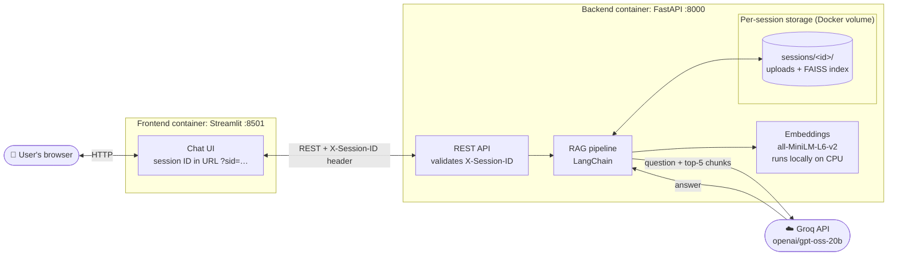
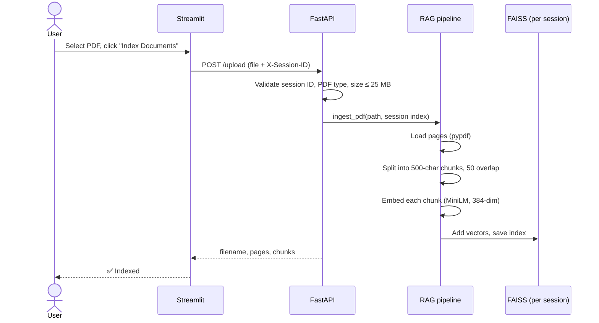
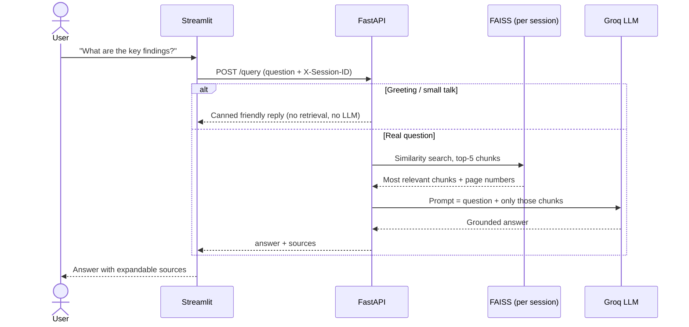
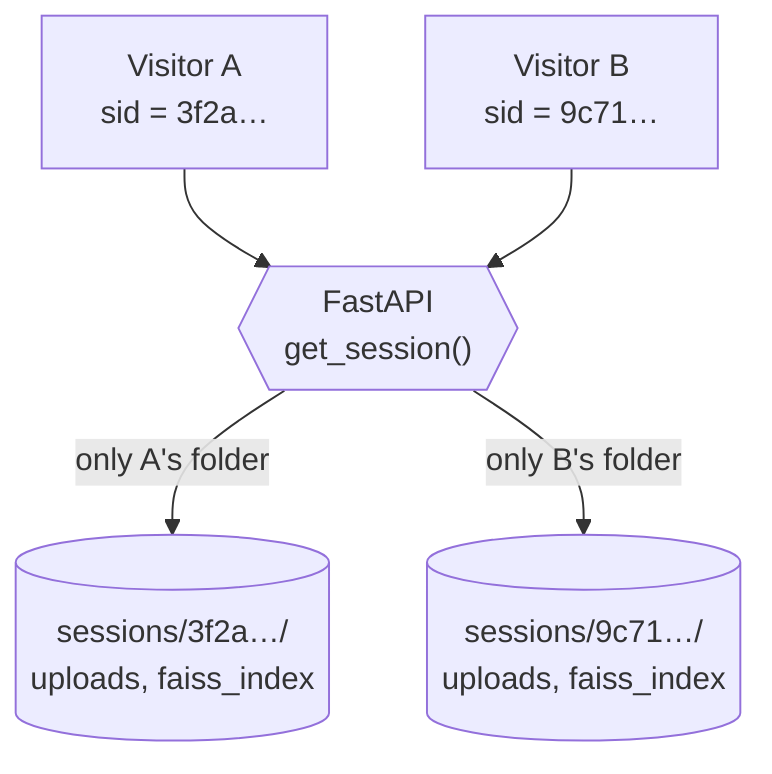
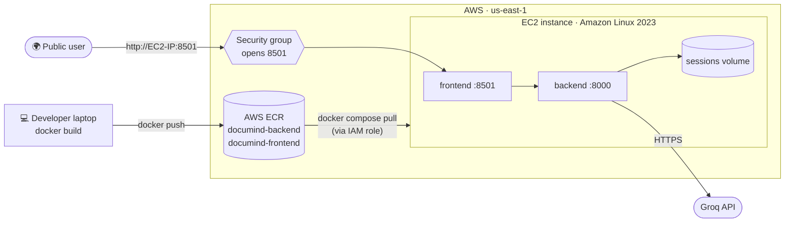

# 📄 DocuMind — AI Research Assistant

> Upload a PDF. Ask questions in plain English. Get answers grounded in your document, with the source passages shown.

DocuMind is a **Retrieval-Augmented Generation (RAG)** web app. Instead of scrolling through a 60-page report, you upload it, ask a question, and the app finds the most relevant passages and has an LLM answer **only from those passages**.

**Built with:** FastAPI · Streamlit · LangChain · FAISS · HuggingFace embeddings · Groq LLM · Docker · AWS (EC2 + ECR)

**Live Demo-** [Link](http://34.202.81.127:8501/)

---

## Table of contents

1. [Features](#features)
2. [How it works (architecture)](#how-it-works-architecture)
3. [Tech stack](#tech-stack)
4. [Prerequisites](#prerequisites)
5. [Quick start with Docker (recommended)](#quick-start-with-docker-recommended)
6. [Run without Docker (venv)](#run-without-docker-venv)
7. [Configuration](#configuration)
8. [Using the app](#using-the-app)
9. [API reference](#api-reference)
10. [Project structure](#project-structure)
11. [Deploying to AWS](#deploying-to-aws)
12. [Troubleshooting](#troubleshooting)
13. [Design decisions](#design-decisions)
14. [Known limitations](#known-limitations)
15. [Roadmap](#roadmap)
16. [Author](#author)

---

## Features

- **Chat with PDFs**: upload one or more PDFs and ask questions in natural language.
- **Source citations**: every answer comes with the exact chunks (and page numbers) it was based on, so you can verify it.
- **Grounded answers**: the model is instructed to answer only from retrieved context and to say so when the answer isn't in the document.
- **Private sessions**: each browser gets its own isolated workspace (own uploads, own search index). Two visitors never see each other's documents.
- **Delete my data**: one button wipes your uploaded files and index.
- **Small-talk handling**: greetings like "hi" or "thanks" get an instant friendly reply without wasting a retrieval or an LLM call.
- **Safe uploads**: only PDFs, capped at 25 MB, filenames sanitised.
- **Auto cleanup**: sessions idle for more than 24 hours are deleted automatically.
- **Interactive API docs**: FastAPI's Swagger UI at `/docs`.
- **One-command run**: `docker compose up --build` starts everything, with a health check so the UI only starts once the API is ready.

---

## How it works (architecture)

### System overview



### What happens when you upload a PDF



### What happens when you ask a question



### Session isolation



Streamlit generates a random UUID per visitor and keeps it in the URL. Every API call carries it in an `X-Session-ID` header. The backend validates that it is a real UUID (which blocks path-traversal tricks like `../`) and only ever touches that visitor's folder.

---

## Tech stack

| Layer | Technology | Why |
|---|---|---|
| Frontend | Streamlit | Chat UI in pure Python |
| Backend | FastAPI + Uvicorn | Fast, typed, auto-generated API docs |
| Orchestration | LangChain | Retrieval chain and prompt plumbing |
| Embeddings | `sentence-transformers/all-MiniLM-L6-v2` | Free, runs locally on CPU (~90 MB download, 384-dim vectors) |
| Vector store | FAISS (`faiss-cpu`) | Fast similarity search with no separate database server |
| LLM | Groq: `openai/gpt-oss-20b` | Very fast inference, free tier available |
| PDF parsing | pypdf | Page-aware text extraction |
| Containers | Docker + Docker Compose | Reproducible, one-command setup |
| Cloud | AWS EC2 + ECR | Container hosting and image registry |

---

## Prerequisites

| You need | Version | Check with |
|---|---|---|
| **Git** | any recent | `git --version` |
| **Groq API key** (free) | n/a | Create one at [console.groq.com/keys](https://console.groq.com/keys) |
| **Docker Desktop** *(Docker route)* | 4.x or newer, includes Compose v2 | `docker --version` and `docker compose version` |
| **Python 3.11** *(venv route only)* | 3.11 recommended (3.10 to 3.12 work) | `python --version` |

> ⚠️ **Python 3.13 is not supported** by the pinned PyTorch version (2.2.2). Use Python 3.11. The Docker images already use 3.11, so the Docker route has no version worries.

Disk and RAM: allow about 3 GB of free disk space (PyTorch and models) and 4 GB of RAM.

---

## Quick start with Docker (recommended)

Works the same on Windows, macOS and Linux.

**1. Clone the repository**

```bash
git clone https://github.com/vedantparikh21/Documind-RAG.git
cd Documind-RAG
```

**2. Create your `.env` file** with your Groq key

```bash
# macOS / Linux / Git Bash
cp .env.example .env

# Windows PowerShell
copy .env.example .env
```

Open `.env` and replace the placeholder:

```env
GROQ_API_KEY=gsk_your_real_key_here
```

> 🔒 `.env` is git-ignored. Never commit your key. Make sure there are no spaces or quotes around it.

**3. Start Docker Desktop** and wait until it says it is running.

**4. Build and run**

```bash
docker compose up --build
```

The first build takes a few minutes (it downloads PyTorch and the embedding model). Later starts take seconds.

**5. Open the app**

| What | URL |
|---|---|
| App (Streamlit) | http://localhost:8501 |
| API docs (Swagger) | http://localhost:8000/docs |
| Health check | http://localhost:8000/health |

> Use `localhost`, not `0.0.0.0`. The `0.0.0.0` that appears in the logs only means "listening on all interfaces". It is not a browsable address.

**Stop it:** press `Ctrl + C`, then run `docker compose down`.
**Wipe stored data too:** `docker compose down -v`.

---

## Run without Docker (venv)

Use this if you want to edit code with auto-reload.

**1. Clone** (same as above) and enter the folder.

**2. Create and activate a virtual environment (Python 3.11)**

```bash
# Windows PowerShell
py -3.11 -m venv .venv
.venv\Scripts\Activate.ps1
# If PowerShell blocks the script:
#   Set-ExecutionPolicy -Scope Process -ExecutionPolicy Bypass

# macOS / Linux
python3.11 -m venv .venv
source .venv/bin/activate
```

Your prompt should now start with `(.venv)`.

**3. Install dependencies** (one file at the repo root installs backend and frontend)

```bash
python -m pip install --upgrade pip
pip install -r requirements.txt
```

This can take 5 to 10 minutes (PyTorch is large).

> 🍎 **macOS note:** the pinned `torch==2.2.2+cpu` build is for Windows and Linux. On macOS, use the Docker route above.

**4. Add your Groq key**: create `.env` in the repo root exactly as in the Docker steps.

**5. Start the backend** (terminal 1, venv active)

```bash
cd backend
uvicorn main:app --reload --port 8000
```

Wait for `Application startup complete`. The first run downloads the embedding model.

**6. Start the frontend** (terminal 2, activate the venv again)

```bash
cd frontend
streamlit run app.py --server.maxUploadSize=25
```

Streamlit opens http://localhost:8501. If the backend is not on the default `http://localhost:8000`, set `BACKEND_URL` first.

---

## Configuration

**Environment variables**

| Variable | Used by | Default | Purpose |
|---|---|---|---|
| `GROQ_API_KEY` | backend | none (required) | Authenticates calls to Groq |
| `BACKEND_URL` | frontend | `http://localhost:8000` | Where the UI finds the API (Compose sets it to `http://backend:8000`) |

**Tunables in `backend/config.py`**

| Setting | Value | Meaning |
|---|---|---|
| `CHUNK_SIZE` / `CHUNK_OVERLAP` | 500 / 50 | Characters per chunk and overlap between chunks |
| `TOP_K_CHUNKS` | 5 | Chunks retrieved per question |
| `EMBEDDING_MODEL_NAME` | all-MiniLM-L6-v2 | Embedding model |
| `GROQ_MODEL_NAME` | openai/gpt-oss-20b | LLM |
| `MAX_UPLOAD_MB` | 25 | Upload size cap (HTTP 413 above this) |
| `SESSION_TTL_HOURS` | 24 | Idle sessions older than this are deleted |

---

## Using the app

1. Open http://localhost:8501.
2. In the sidebar, choose one or more PDFs and click **⚡ Index Documents**.
3. Your files appear under **Indexed Documents**.
4. Type a question in the chat box, for example *"Summarise the main conclusions"*.
5. Open **📎 Sources** under an answer to see exactly which passages were used.
6. **Clear Chat** resets the conversation. **Flush All Documents** deletes *your* files and index.

**Tip:** your session lives in the URL (`?sid=…`). Bookmark it to come back to your documents. Open the app in a private window to get a brand-new, empty workspace.

---

## API reference

Interactive docs: **http://localhost:8000/docs**

Every endpoint except `/health` requires an `X-Session-ID` header containing a UUID.

| Method | Endpoint | Description |
|---|---|---|
| GET | `/health` | Liveness check (no header needed) |
| GET | `/documents` | List this session's indexed documents |
| POST | `/upload` | Upload and index a PDF (multipart `file`) |
| POST | `/query` | Ask a question; body `{"question": "..."}` |
| DELETE | `/documents` | Delete this session's files and index |

**Try it with curl**

```bash
# 1. Make a session ID (any UUID works)
SID=$(python -c "import uuid; print(uuid.uuid4())")

# 2. Upload a PDF
curl -X POST http://localhost:8000/upload \
  -H "X-Session-ID: $SID" \
  -F "file=@my-report.pdf"

# 3. Ask a question
curl -X POST http://localhost:8000/query \
  -H "X-Session-ID: $SID" \
  -H "Content-Type: application/json" \
  -d '{"question": "What is this document about?"}'
```

**In Swagger UI:** click an endpoint, then *Try it out*, paste a UUID into the `x-session-id` field, and *Execute*. Use the **same** UUID on every call to act as one visitor, and a different UUID to see another visitor's empty workspace.

**Status codes:** `400` no documents indexed yet or bad file or session ID, `413` file too large, `400`/`422` missing or invalid session ID, `500` server or LLM error.

---

## Project structure

```
Documind-RAG/
├── backend/
│   ├── main.py             # FastAPI app, endpoints, session handling
│   ├── rag_pipeline.py     # Load, chunk, embed, store, retrieve, answer
│   ├── config.py           # All tunable settings
│   ├── requirements.txt    # Backend deps (used by the Docker build)
│   ├── Dockerfile
│   └── .dockerignore
├── frontend/
│   ├── app.py              # Streamlit chat UI
│   ├── requirements.txt    # Frontend deps (used by the Docker build)
│   ├── Dockerfile
│   └── .dockerignore
├── docker-compose.yml      # Runs both services together
├── requirements.txt        # Installs both (for running without Docker)
├── .env.example            # Template for your secrets
└── README.md
```

Created at runtime (git-ignored): `backend/sessions/<id>/{uploads, faiss_index, documents.json}`.

---

## Deploying to AWS

The live version runs as two containers on a single **EC2** instance, with images stored in **ECR** (Elastic Container Registry).



**Outline**

1. Create two private ECR repositories: `documind-backend` and `documind-frontend`.
2. Build both images locally and push them to ECR.
3. Launch an EC2 instance (Amazon Linux 2023) with an IAM role that allows pulling from ECR, and open port 8501 in its security group.
4. Install Docker and the Compose plugin on the instance.
5. Copy `docker-compose.yml` (pointing at the ECR image URLs) and a `.env` with the Groq key onto the instance.
6. Log in to ECR, then `docker compose pull && docker compose up -d`.

Notes: ECR login tokens expire after 12 hours, and an EC2 public IP changes when the instance is stopped and started (use an Elastic IP for a stable address). Only port 8501 needs to be public; the frontend reaches the backend over Docker's internal network.

---

## Troubleshooting

| Problem | Fix |
|---|---|
| `failed to connect to the docker API` / `npipe` error | Docker Desktop is not running. Start it and retry. |
| `http://0.0.0.0:8501` doesn't load | Use `http://localhost:8501`. |
| `401 Invalid API Key` from the LLM | Wrong or malformed `GROQ_API_KEY`: no quotes, no spaces, no stray characters. After fixing, run `docker compose up -d --force-recreate`. |
| `pip install` fails on `torch==2.2.2+cpu` | You are probably on Python 3.13 or on macOS. Use Python 3.11, or use Docker. |
| UI says it can't reach the backend | Backend still starting (the first run downloads the model). Wait for the health check, or check `docker compose logs backend`. |
| Port 8000 or 8501 already in use | Stop the other process, or change the left side of the port mapping in `docker-compose.yml`. |
| `413` on upload | The PDF is over 25 MB. |
| Documents vanished | Sessions idle for more than 24 h are deleted, or you opened a new private window (new session). |

---

## Design decisions

- **Per-session folders instead of one shared index.** A shared index would let one visitor's questions retrieve another visitor's documents. Isolating by session ID fixes that without needing user accounts or a database.
- **Local embeddings, hosted LLM.** Embedding is cheap and runs on CPU, so no API cost or data leaves the machine for that step. Only the question and the five retrieved chunks go to Groq.
- **CPU-only PyTorch.** The CUDA build adds gigabytes to the image for no benefit here.
- **FAISS over a vector database.** For per-user, small-to-medium PDFs, an on-disk index is simpler and faster than running another service.
- **Temperature 0.** Answers should be reproducible and stick to the source text.
- **Health check plus `depends_on: service_healthy`.** The UI never starts before the API (and its model) is ready.
- **Separate requirements per service.** Each Docker build context is its own folder, so each image needs its own file. The root file exists for convenient local installs.

---

## Known limitations

- Text-based PDFs only. Scanned PDFs have no text layer (no OCR yet).
- Session identity is a URL token, not a login. Anyone with your full URL can see your documents.
- Single-instance deployment with local disk storage; no horizontal scaling.
- Answers cover the top 5 chunks only, so questions that need the whole document ("summarise all 200 pages") are weaker.
- HTTP only on the demo deployment (no custom domain or TLS).

## Roadmap

- [ ] OCR for scanned PDFs
- [ ] Support DOCX and TXT
- [ ] Conversation memory for follow-up questions
- [ ] Re-ranking and hybrid (keyword + vector) search
- [ ] Real authentication
- [ ] HTTPS with a custom domain, CI/CD to ECR and EC2

---

## Author

**Vedant Parikh**: [GitHub @vedantparikh21](https://github.com/vedantparikh21)